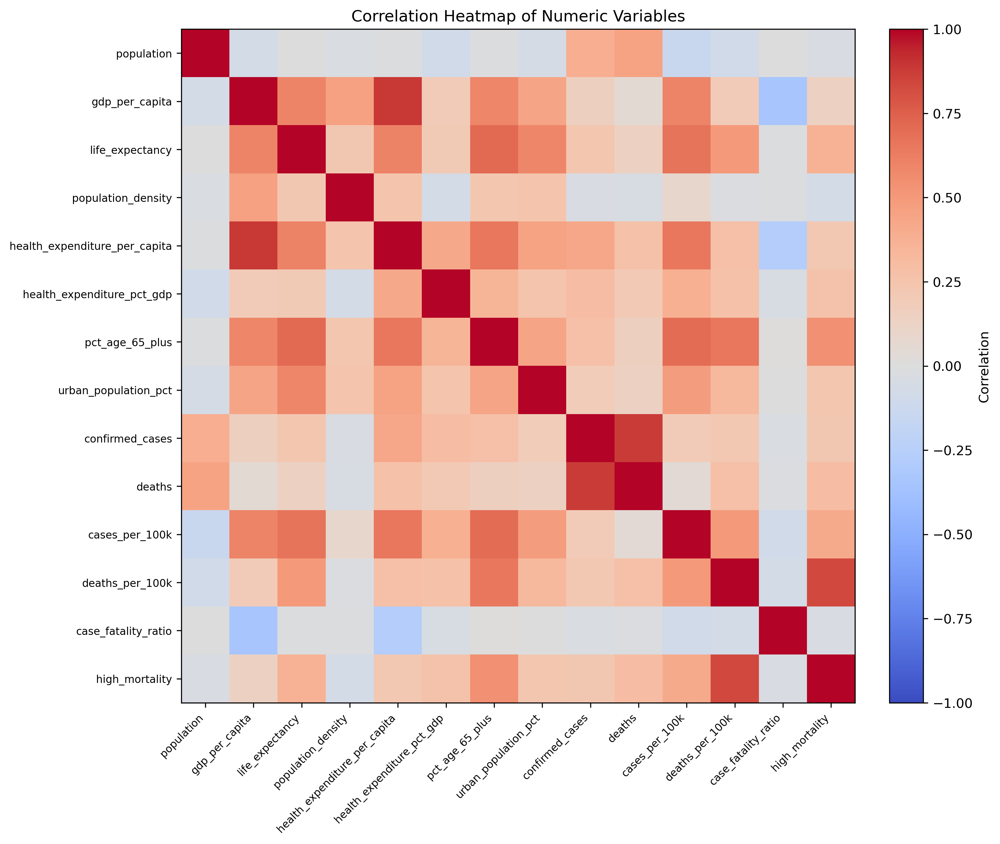
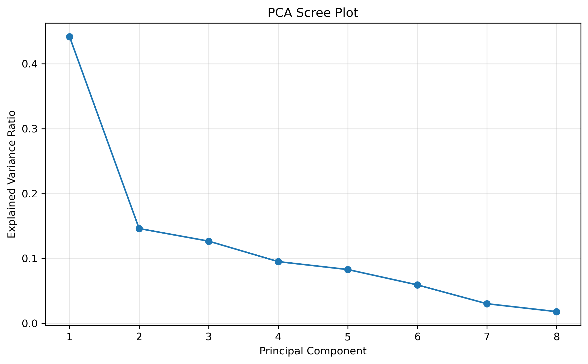
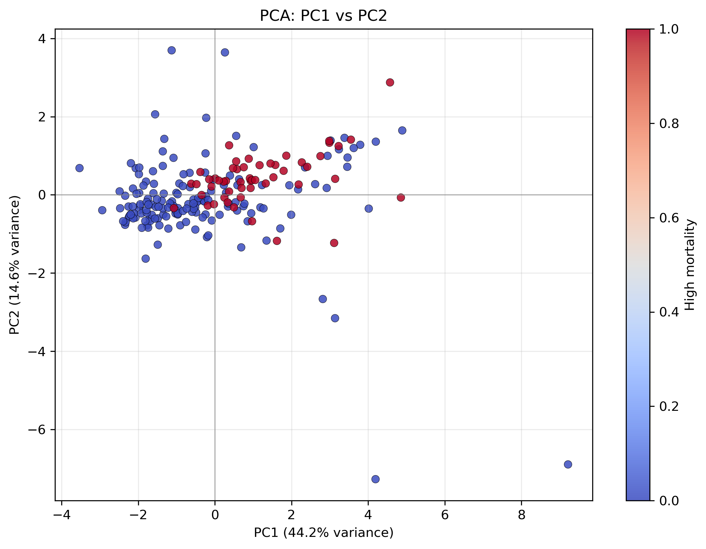
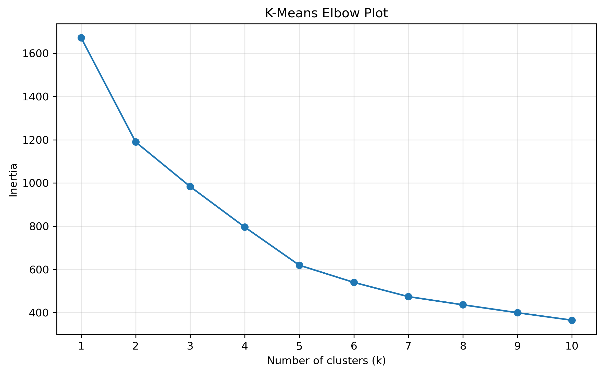
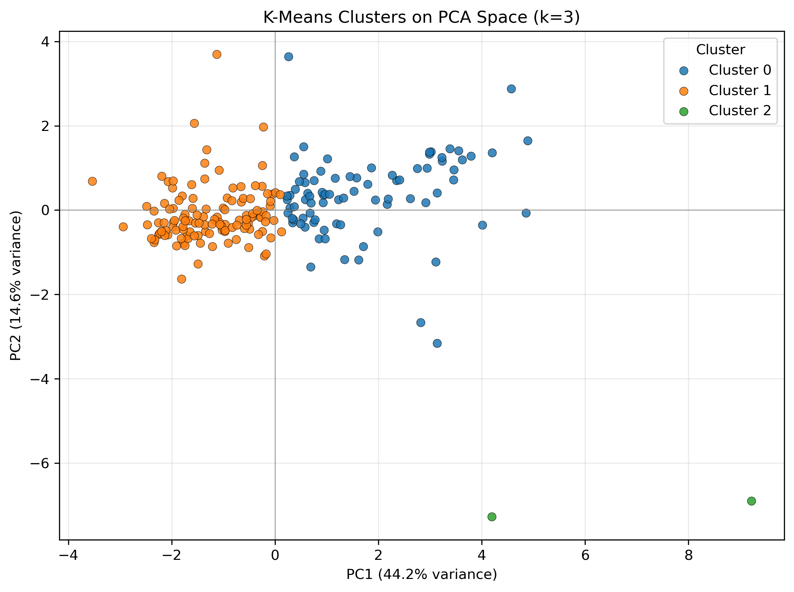
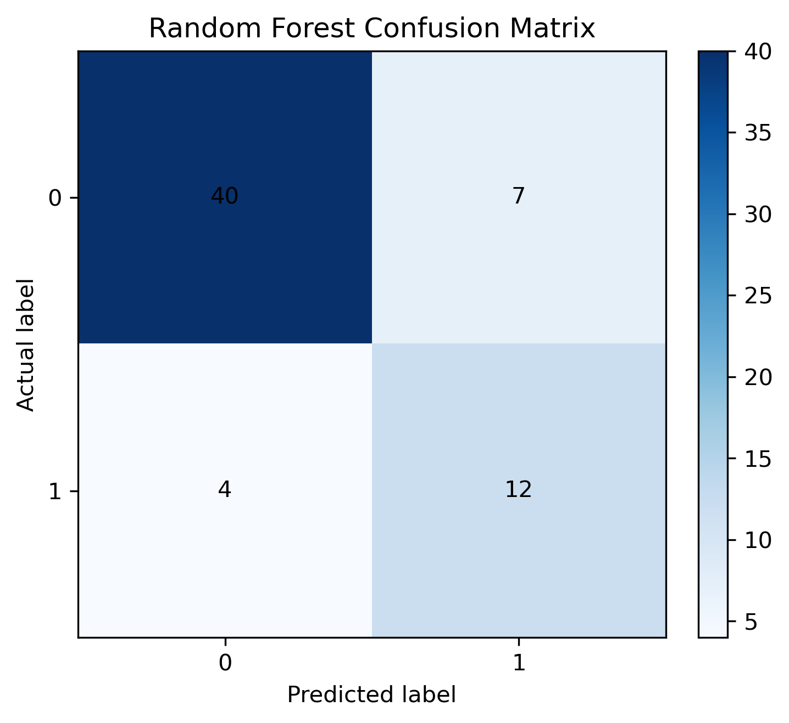
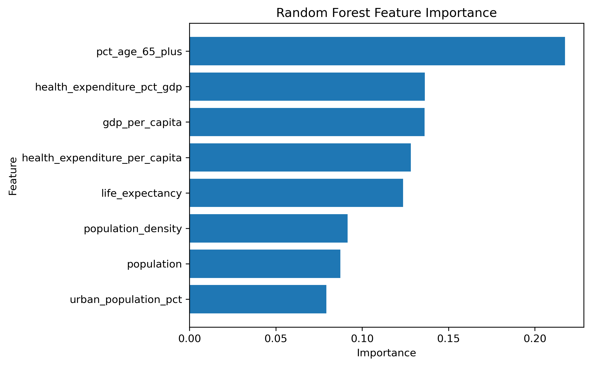

---
format:
  pdf:
    toc: false
    number-sections: true
    fontsize: 9pt
    geometry:
      - margin=0.45in
  html:
    toc: false
    number-sections: true
execute:
  echo: false
  warning: false
  message: false
---

# Global COVID-19 Pandemic Profiles: Clustering Countries and Identifying Factors Associated with High Mortality {.unnumbered}

# Abstract {.unnumbered}

This project examines cross-country COVID-19 mortality patterns by combining Johns Hopkins CSSE COVID-19 data with World Bank World Development Indicators. A cloud-based data engineering workflow using Google Cloud Storage and BigQuery was used to prepare a country-level modeling table containing demographic, economic, healthcare, regional, and COVID outcome variables for 209 countries. The analysis used exploratory data analysis, Principal Component Analysis, K-Means clustering, and Random Forest classification to identify major country profiles and predictors associated with high COVID-19 mortality.

The results indicate that COVID-19 mortality rates were highly uneven across countries and right-skewed. PCA showed that the first principal component explained approximately 44% of the variance and was dominated by development-related characteristics, including GDP per capita, life expectancy, healthcare spending, and age structure. K-Means clustering suggested that a three-cluster solution was the most interpretable, separating countries into broad higher-development, lower-income, and small wealthy high-density outlier profiles. A Random Forest classifier predicted whether a country belonged to the highest mortality quartile with approximately 82.5% accuracy and 75% recall. The most important predictors were the share of the population age 65 and older, health expenditure as a percent of GDP, GDP per capita, health expenditure per capita, and life expectancy. These findings suggest that COVID-19 mortality outcomes were associated with demographic age structure, economic development, and healthcare-system characteristics, though the results are correlational rather than causal.

**Brian Ngan**  
**Email:** brianngan@ucsb.edu

\newpage

# Introduction

The COVID-19 pandemic affected countries unevenly. Some countries experienced relatively low mortality rates, while others experienced substantially higher deaths per 100,000 population. Understanding these differences is important for describing global pandemic patterns and for identifying country-level characteristics associated with severe mortality outcomes.

This project asks: **Which country-level demographic, economic, and healthcare characteristics are associated with higher COVID-19 mortality across countries?** The analysis focuses on country-level pandemic profiles and high-mortality classification. The primary mortality outcome is deaths per 100,000 population, and the supervised learning target identifies countries in the highest mortality quartile.

Studying cross-country differences in COVID-19 mortality is important because pandemic outcomes reflect more than viral transmission alone. Mortality patterns can also be shaped by age structure, baseline population health, health-system capacity, economic resources, urbanization, and differences in reporting infrastructure. Prior public health and epidemiological research has consistently shown that older age distributions, healthcare access, and socioeconomic conditions are closely related to COVID-19 severity and mortality. These relationships make demographic, economic, and healthcare indicators relevant predictors for a country-level analysis.

This dataset is valuable from both a data science and public health perspective because it combines global health outcomes with standardized international development indicators. The COVID-19 data provide comparable pandemic outcome measures, while the World Bank indicators provide structured predictors that describe pre-pandemic country conditions. PCA, K-Means clustering, and Random Forest classification were selected because they address complementary goals: PCA summarizes correlated predictors, K-Means explores country profiles without using mortality labels, and Random Forest evaluates which structural variables are most useful for predicting high-mortality status.

The project combines unsupervised and supervised learning. PCA is used to summarize correlated demographic, economic, and healthcare predictors. K-Means clustering is used to identify exploratory country profiles. Random Forest classification is used to predict whether a country belongs to the highest COVID-19 mortality quartile and to rank important predictors.

A secondary goal of the project is to demonstrate a cloud-based data analytics workflow. Raw COVID-19 and World Bank data were staged and transformed through Google Cloud Storage and BigQuery before local Python analysis. This separates data engineering from statistical modeling and mirrors a scalable analytics workflow, even though the final modeling dataset is modest in size.

\newpage

# Data

## Data Sources

The project uses two primary datasets.

First, COVID-19 confirmed cases and deaths come from the Johns Hopkins CSSE COVID-19 repository. The analysis uses the global confirmed cases time series, global deaths time series, and Johns Hopkins ISO lookup table. The final cumulative date in the time-series files is March 9, 2023.

Second, country-level predictors come from the World Bank World Development Indicators. The selected indicators measure population, GDP per capita, life expectancy, population density, current health expenditure per capita, health expenditure as a percent of GDP, population age 65 and older, and urban population percentage. For WDI predictors, 2019 values were preferred because they represent pre-pandemic country characteristics. When 2019 values were unavailable, 2020 values were used as fallback.

Region metadata was derived from World Bank country metadata and collapsed into broad regions for descriptive analysis and visualization.

## Dataset Background and Rationale

The Johns Hopkins Center for Systems Science and Engineering maintained one of the most widely used global COVID-19 case and death repositories during the pandemic. The World Bank collects and publishes the World Development Indicators, a major international database of socioeconomic, demographic, and health-system measures. These datasets were chosen because they are publicly available, widely used by researchers and policymakers, and provide broad international coverage. Combining COVID-19 outcomes with development indicators allows meaningful country-level comparisons between pandemic mortality and structural country characteristics.

## Data Engineering Workflow

The data engineering workflow used Google Cloud Storage and BigQuery. Raw files were downloaded locally, uploaded to cloud storage, and loaded into BigQuery raw tables. SQL transformations then produced three analytics tables:

- `jhu_country_covid`, containing one row per country with cumulative confirmed cases and deaths.
- `wdi_country_features`, containing one row per country with selected WDI predictors.
- `country_covid_wdi_modeling`, the final modeling table joining COVID outcomes, WDI predictors, and region labels.

The final modeling table contained 209 countries and 20 columns. The main outcome variable was `deaths_per_100k`. The binary classification target, `high_mortality`, was equal to 1 for countries in the highest mortality quartile and 0 otherwise.

## Final Variables

The final modeling table included country identifiers, region labels, country-level predictors, COVID outcomes, rate variables, quartile variables, and the supervised learning target. Key variables included:

- `population`
- `gdp_per_capita`
- `life_expectancy`
- `population_density`
- `health_expenditure_per_capita`
- `health_expenditure_pct_gdp`
- `pct_age_65_plus`
- `urban_population_pct`
- `confirmed_cases`
- `deaths`
- `cases_per_100k`
- `deaths_per_100k`
- `case_fatality_ratio`
- `mortality_quartile`
- `high_mortality`

Missingness was limited. The main missing values were in GDP per capita and health expenditure variables. These were handled using median imputation during PCA, clustering, and Random Forest modeling.

\newpage

# Methodology

## Exploratory Data Analysis

Exploratory analysis examined dataset structure, missingness, summary statistics, mortality distributions, and correlations among numeric variables. Distribution plots were used to inspect skewness and outliers. A correlation heatmap was used to identify associations among country characteristics and deaths per 100,000 population.

## Principal Component Analysis

PCA was applied to the continuous structural predictors:

- `population`
- `gdp_per_capita`
- `life_expectancy`
- `population_density`
- `health_expenditure_per_capita`
- `health_expenditure_pct_gdp`
- `pct_age_65_plus`
- `urban_population_pct`

Identifiers, region variables, quartiles, COVID outcome variables, and the `high_mortality` target were excluded from PCA. Missing predictor values were imputed using the median, and variables were standardized with `StandardScaler` before fitting PCA. Standardization was necessary because predictors were measured on very different scales.

PCA was used because many of the predictors are conceptually and statistically related. For example, GDP per capita, life expectancy, healthcare spending, urbanization, and age structure often move together across countries. PCA reduces this correlated predictor set into a smaller number of components, making it easier to identify major patterns in country characteristics and visualize countries in a lower-dimensional space.

## K-Means Clustering

K-Means clustering was applied to the same standardized predictor matrix used for PCA. The elbow method was used to compare inertia values for `k = 1` through `k = 10`. Two candidate clustering solutions were evaluated: `k = 3` and `k = 4`.

The clustering analysis considered cluster sizes, standardized centroids, original-scale centroid summaries, and visualization of cluster assignments in the PC1-PC2 space. Because K-Means is sensitive to extreme observations, special attention was given to small outlier clusters.

K-Means was used to explore whether countries naturally grouped into similar structural profiles before considering the mortality label. This unsupervised approach helps identify patterns in demographic, economic, and healthcare characteristics without forcing countries into pre-defined categories or using the high-mortality target during clustering.

## Random Forest Classification

Random Forest classification was used to predict the binary `high_mortality` target. The same eight structural predictors used in PCA and K-Means were used as model features. COVID outcome variables, mortality quartile, identifiers, and region labels were excluded to avoid leakage and preserve interpretability.

The data were split into training and test sets using a stratified 70/30 split with `random_state = 42`. Missing values were imputed using the training-set median. The classifier used 500 trees and `random_state = 42`. Model performance was evaluated using accuracy, precision, recall, F1 score, a classification report, and a confusion matrix. Feature importance was used to identify the predictors most useful for classification.

Random Forest was selected because it can model nonlinear relationships and interactions among predictors while requiring relatively few distributional assumptions. In this project, it provides a supervised learning comparison to the PCA and clustering results by testing whether the same country-level characteristics can predict membership in the highest mortality quartile. Feature importance also provides an interpretable summary of which variables were most useful to the classifier.

\newpage

# Results

## Exploratory Analysis Results

The final dataset contained 209 countries. Missingness was limited and concentrated mainly in GDP and healthcare expenditure variables. The classification target was moderately imbalanced, with 157 countries in the non-high-mortality group and 52 countries in the high-mortality group.

COVID mortality outcomes were right-skewed. Most countries had lower or moderate deaths per 100,000 population, while a smaller number had very high mortality rates. Cases per 100,000 and GDP per capita were also right-skewed, indicating substantial cross-country heterogeneity and the presence of outliers. Life expectancy was comparatively more symmetric, though it still varied meaningfully across countries.

The correlation analysis in @fig-correlation-heatmap showed that `pct_age_65_plus` had the strongest positive correlation with `deaths_per_100k`, approximately 0.65. `cases_per_100k` and `life_expectancy` were also positively correlated with deaths per 100,000. Health expenditure variables had moderate positive associations with mortality. These correlations indicate association, not causation, and should be interpreted in the context of country-level reporting differences and demographic structure.

{#fig-correlation-heatmap fig-align="center" fig-pos="H" width="62%"}

@fig-correlation-heatmap summarizes the bivariate relationships among COVID outcomes, demographic variables, economic variables, and healthcare measures. The strongest mortality relationship is with age structure, while development-related variables such as life expectancy and healthcare spending also move together. The heatmap also shows why multivariate methods are useful: many predictors are correlated with one another, so single-variable interpretations would miss the broader development and demographic structure in the data.

## PCA Results

As shown in @fig-pca-scree, PCA showed that the first principal component explained approximately 44% of the variance in the standardized predictor set. PC1 was dominated by development-related variables, including GDP per capita, life expectancy, health expenditure per capita, age structure, and urbanization. High PC1 scores therefore represented countries that were wealthier, older, more urbanized, longer-lived, and higher-spending on healthcare.

{#fig-pca-scree fig-align="center" fig-pos="H" width="43%"}

@fig-pca-scree shows that the largest drop occurs after the first principal component, meaning PC1 captures the strongest shared dimension among the predictors. Later components still add information, but each additional component contributes a smaller share of variance. This supports using PCA as a summary of correlated country characteristics rather than treating all predictors as fully independent dimensions.

PC2 captured a different contrast involving health expenditure as a percent of GDP and population density. High PC2 scores were associated with higher healthcare expenditure share and lower density, while low PC2 scores were associated with very high population density. Four principal components explained roughly 81% of the total variance, indicating that a small number of dimensions captured much of the shared structure in the predictors.

The PCA scatterplot in @fig-pca-scatter suggested partial, but not perfect, separation between high-mortality and non-high-mortality countries. This supports the interpretation that mortality patterns are related to underlying demographic and development dimensions but are not fully determined by them.

{#fig-pca-scatter fig-align="center" fig-pos="H" width="43%"}

@fig-pca-scatter shows that high-mortality countries tend to appear more often in parts of the PCA space associated with older, higher-development profiles, but the classes overlap. This overlap is important: PCA reveals structure in the predictors, but it does not create a clean boundary between high- and lower-mortality countries. The plot therefore supports a nuanced interpretation in which structural predictors are informative but incomplete.

## K-Means Results

The elbow plot in @fig-kmeans-elbow suggested approximately 3 to 4 clusters, but it did not show a perfectly clear choice of `k`. The three-cluster solution was more interpretable than the four-cluster solution because it produced two large substantive groups and one small outlier group. The four-cluster solution mainly introduced an additional tiny outlier cluster.

{#fig-kmeans-elbow fig-align="center" fig-pos="H" width="43%"}

@fig-kmeans-elbow shows steadily decreasing inertia as more clusters are added, with the most visible bend occurring around three or four clusters. Because the curve does not contain a sharp break, the final choice of `k` was based on both the elbow pattern and interpretability of the resulting country profiles.

For `k = 3`, the clusters had approximate sizes of 82, 125, and 2 countries. One large cluster represented countries with older populations, higher life expectancy, greater urbanization, and higher healthcare spending. Another large cluster represented younger, lower-income country profiles. The small outlier cluster contained extremely dense and wealthy country-level observations, including Macao SAR, China and Monaco.

{#fig-kmeans-clusters fig-align="center" fig-pos="H" width="43%"}

@fig-kmeans-clusters displays the preferred three-cluster solution in the PCA space. The two major clusters separate primarily along the development-related PC1 axis, while the two-country cluster sits apart from the rest of the dataset. This visual pattern reinforces the interpretation that the small cluster is an outlier group rather than a broad global pandemic profile.

These results should be interpreted as exploratory profiles rather than fixed country categories. K-Means is sensitive to extreme observations, and the tiny outlier cluster is a reminder that high-density or high-income extremes can strongly affect Euclidean-distance clustering.

## Random Forest Results

The Random Forest classifier achieved approximately 82.5% accuracy on the test set. Recall for high-mortality countries was approximately 75%, meaning the model identified most countries in the highest mortality quartile. Precision for the high-mortality class was lower, approximately 63%, indicating that some countries predicted as high mortality were not actually in the highest quartile.

The confusion matrix in @fig-rf-confusion showed 40 true negatives, 7 false positives, 4 false negatives, and 12 true positives. The model improved on the majority-class baseline accuracy of approximately 74.6%, but the improvement should be interpreted as moderate due to the small sample size and single train/test split.

{#fig-rf-confusion fig-align="center" fig-pos="H" width="25%"}

@fig-rf-confusion shows that the model correctly identified most non-high-mortality countries and captured most high-mortality countries in the test set. The presence of both false positives and false negatives indicates that the country-level predictors are useful but not sufficient for perfectly classifying mortality outcomes.

The most important Random Forest predictors were:

- `pct_age_65_plus`
- `health_expenditure_pct_gdp`
- `gdp_per_capita`
- `health_expenditure_per_capita`
- `life_expectancy`

These results align with the PCA and correlation findings. Age structure, economic development, and healthcare-system characteristics appeared repeatedly across PCA loadings, correlation analysis, cluster profiles, and feature importance rankings. Feature importance should still be interpreted cautiously because many predictors are correlated and impurity-based importance does not establish causality.

{#fig-rf-importance fig-align="center" fig-pos="H" width="30%"}

@fig-rf-importance ranks the predictors by their contribution to Random Forest classification. The highest-ranked variable is the share of the population age 65 and older, followed by healthcare expenditure measures and GDP per capita. This pattern is consistent with the EDA and PCA results, but the rankings should be read as predictive importance within this model rather than causal effects.

\newpage

# Conclusion and Future Work

This project found that country-level COVID-19 mortality patterns were associated with demographic structure, economic development, and healthcare-system characteristics. Countries with older populations, higher life expectancy, higher GDP per capita, and greater healthcare spending tended to occupy distinct positions in PCA space and were more relevant to the Random Forest model's high-mortality predictions.

The agreement across PCA, K-Means clustering, and Random Forest classification increases confidence that the analysis captured meaningful demographic-development dimensions. However, these methods do not prove causality. The findings should be interpreted as descriptive and predictive associations rather than evidence that any individual variable caused higher mortality.

Practically, the results suggest that population age structure and healthcare-related indicators are important dimensions to monitor when comparing pandemic vulnerability across countries. The prominence of `pct_age_65_plus` is consistent with the known role of older age in COVID-19 mortality risk, while the importance of health expenditure variables suggests that healthcare systems and reporting capacity may be closely tied to observed mortality patterns. These findings do not imply that higher health spending caused higher mortality; rather, they show that mortality outcomes were associated with broader demographic and development profiles.

The project also illustrates the value of combining machine learning with public health data. PCA and clustering helped describe broad country profiles, while Random Forest provided a predictive view of high-mortality classification. Similar workflows could support future disease surveillance, policy analysis, and rapid comparison of countries during emerging public health crises, especially when paired with careful domain knowledge and transparent limitations.

The analysis has several limitations. It uses cross-sectional country-level data, which cannot capture within-country variation or pandemic dynamics over time. The sample size is limited to 209 countries, and supervised learning performance was evaluated using a single train/test split. COVID case and death reporting also varied across countries, and the final results depend on the selected Johns Hopkins reporting period.

Future work could extend the analysis by incorporating additional years of data, using time-series methods, adding more socioeconomic and public health indicators, comparing alternative models, and conducting robustness checks using cross-validation, permutation importance, alternative mortality thresholds, or regional subgroup analyses.

\newpage

# References

Johns Hopkins University Center for Systems Science and Engineering. COVID-19 Data Repository by the Center for Systems Science and Engineering (CSSE) at Johns Hopkins University. <https://github.com/CSSEGISandData/COVID-19>

World Bank. World Development Indicators. <https://datacatalog.worldbank.org/search/dataset/0037712/world-development-indicators>

O'Driscoll, M., Ribeiro Dos Santos, G., Wang, L., Cummings, D. A. T., Azman, A. S., Paireau, J., Fontanet, A., Cauchemez, S., and Salje, H. (2021). Age-specific mortality and immunity patterns of SARS-CoV-2. *Nature*, 590, 140-145.

Williamson, E. J., Walker, A. J., Bhaskaran, K., Bacon, S., Bates, C., Morton, C. E., Curtis, H. J., Mehrkar, A., Evans, D., Inglesby, P., Cockburn, J., McDonald, H. I., MacKenna, B., Tomlinson, L., Douglas, I. J., Rentsch, C. T., Mathur, R., Wong, A. Y. S., Grieve, R., Harrison, D., Forbes, H., Schultze, A., Croker, R., Parry, J., Hester, F., Harper, S., Perera, R., Evans, S. J. W., Smeeth, L., and Goldacre, B. (2020). Factors associated with COVID-19-related death using OpenSAFELY. *Nature*, 584, 430-436.

Google Cloud. BigQuery Documentation. <https://cloud.google.com/bigquery/docs>

Google Cloud. Cloud Storage Documentation. <https://cloud.google.com/storage/docs>

Python Software Foundation. Python Language Reference. <https://www.python.org/>

Harris, C. R., Millman, K. J., van der Walt, S. J., Gommers, R., Virtanen, P., Cournapeau, D., Wieser, E., Taylor, J., Berg, S., Smith, N. J., Kern, R., Picus, M., Hoyer, S., van Kerkwijk, M. H., Brett, M., Haldane, A., del Rio, J. F., Wiebe, M., Peterson, P., Gerard-Marchant, P., Sheppard, K., Reddy, T., Weckesser, W., Abbasi, H., Gohlke, C., and Oliphant, T. E. (2020). Array programming with NumPy. *Nature*, 585, 357-362.

McKinney, W. (2010). Data Structures for Statistical Computing in Python. *Proceedings of the 9th Python in Science Conference*, 56-61.

Hunter, J. D. (2007). Matplotlib: A 2D Graphics Environment. *Computing in Science & Engineering*, 9(3), 90-95.

Pedregosa, F., Varoquaux, G., Gramfort, A., Michel, V., Thirion, B., Grisel, O., Blondel, M., Prettenhofer, P., Weiss, R., Dubourg, V., Vanderplas, J., Passos, A., Cournapeau, D., Brucher, M., Perrot, M., and Duchesnay, E. (2011). Scikit-learn: Machine Learning in Python. *Journal of Machine Learning Research*, 12, 2825-2830.

\newpage

# Appendix

## BigQuery Pipeline Summary

The BigQuery data engineering pipeline created the following raw tables:

- `jhu_confirmed_global_raw`
- `jhu_deaths_global_raw`
- `jhu_lookup_raw`
- `wdi_indicators_raw`
- `region_lookup_raw`

The pipeline then created the following transformed tables:

- `jhu_country_covid`
- `wdi_country_features`
- `country_covid_wdi_modeling`

## Core Analysis Code

The full analysis code is available in `analysis/covid_wdi_analysis.ipynb`. The following representative Python code excerpt summarizes the main workflow:

```python
# Load final modeling table
df = pd.read_csv("analysis/exports/country_covid_wdi_modeling.csv")

# Select structural predictors
predictors = [
    "population",
    "gdp_per_capita",
    "life_expectancy",
    "population_density",
    "health_expenditure_per_capita",
    "health_expenditure_pct_gdp",
    "pct_age_65_plus",
    "urban_population_pct",
]

# Preprocess predictors
X_imputed = SimpleImputer(strategy="median").fit_transform(df[predictors])
X_scaled = StandardScaler().fit_transform(X_imputed)

# PCA
pca = PCA()
pca_scores = pca.fit_transform(X_scaled)

# K-Means
kmeans = KMeans(n_clusters=3, random_state=42, n_init=10)
clusters = kmeans.fit_predict(X_scaled)

# Random Forest
X_train, X_test, y_train, y_test = train_test_split(
    df[predictors],
    df["high_mortality"],
    test_size=0.30,
    stratify=df["high_mortality"],
    random_state=42,
)

rf = Pipeline([
    ("imputer", SimpleImputer(strategy="median")),
    ("model", RandomForestClassifier(n_estimators=500, random_state=42)),
])

rf.fit(X_train, y_train)
predictions = rf.predict(X_test)
```

## Reproducibility Notes

The project used fixed random seeds for K-Means and Random Forest modeling. The final table was exported from BigQuery and analyzed locally in Python. The cloud workflow, SQL transformation files, and notebook are included in the project folder for reproducibility.
